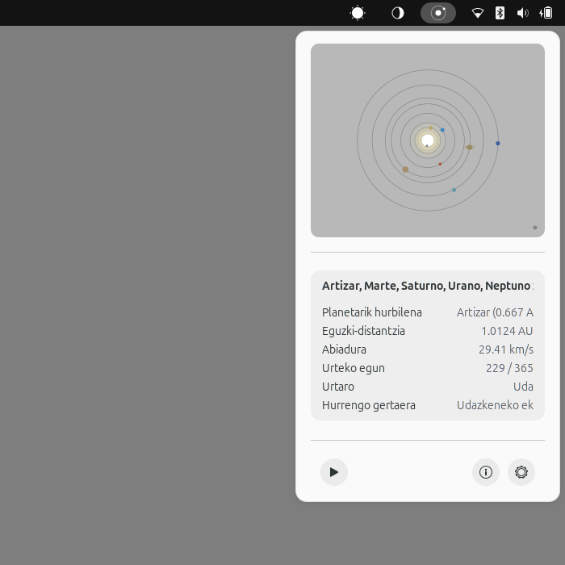
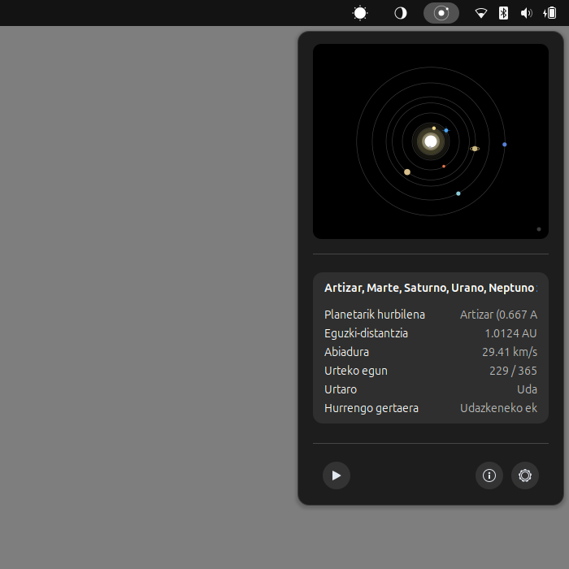

# Gnome Planetarium Extension 🪐

> **Version:** 1.0.0 | **GNOME Shell:** 46 – 50

**Gnome Planetarium Extension** is a GNOME Shell extension that displays a real-time solar system planetarium in the top panel.

Part of **Jakin | Athenaeum** — *A free knowledge desktop ecosystem for science, philosophy, and art.*

It offline-calculates real-time Keplerian orbital mechanics for all 8 planets (Mercury, Venus, Earth, Mars, Jupiter, Saturn, Uranus, Neptune) using NASA/JPL secular rates and Newton-Raphson solvers based on your local coordinates. No external web requests are ever made.

---

## Preview

| Light Mode (Day) | Dark Mode (Night) |
| :---: | :---: |
|  |  |

---

## Features

- **Top Bar Icon**: Minimalist solar system indicator showing Earth and inner planetary orbits rendered dynamically with Cairo.
- **Astronomical Data**: Closest planet to Earth, Earth-Sun distance (AU), orbital velocity (km/s), day of year, astronomical season, and next equinox/solstice event.
- **Settings & Documentation**: A native Libadwaita Preferences window featuring configuration options, a detailed Information page with astronomical explanations, and an About section.
- **Interactive Solar System Diagram**: High-fidelity Cairo-rendered popup showing real-time heliocentric positions of all 8 planets, interactive zoom (0.4x to 5.0x), and hover tooltips.
- **Cairo Vector Rendering**: Uses Cairo with vector drawing for a dynamic and interactive visual representation.
- **Completely Offline**: Runs 100% locally using Keplerian algorithms — no network dependencies, no API calls.
- **Annual Orbit Simulation**: Interactive playback button (▶ / ⏸) to simulate a 1-year orbital sweep across the solar system with smooth fade-reset.

---

## Panel Ordering and Ergonomics

The three astronomical extensions (Gnome Sun Extension, Gnome Moon Extension, and Gnome Planetarium Extension) feature an automatic sibling-ordering mechanism that guarantees a deterministic left-to-right sequence to the left of system status indicators:

`Gnome Sun Extension → Gnome Moon Extension → Gnome Planetarium Extension`

This spatial hierarchy respects Western left-to-right reading direction, human intuition, and cognitive ergonomics: starting at the daily solar cycle (primary circadian anchor), moving through Earth's immediate satellite (the Moon), and concluding at the macroscopic heliocentric scale (the Solar System).

---

## Supported Languages (3 languages)

GnomePlanetarium is fully translated into the following languages:

- **Basque** (`eu`)
- **English** (`en`)
- **Spanish** (`es`)

---

## Installation

Copy the extension directory to your GNOME Shell extensions directory:

```bash
cp -r GnomePlanetariumExtension ~/.local/share/gnome-shell/extensions/gnomeplanetariumextension@aiurri.xyz
```

---

## Activation

### Via terminal:

```bash
gnome-extensions enable gnomeplanetariumextension@aiurri.xyz
```

### Via GUI:
Open **GNOME Extensions** or **Extension Manager** and toggle *Gnome Planetarium Extension* on.

> **Note:** If on Wayland, you must log out and log back in to reload GNOME Shell before the extension becomes visible. On X11, you can restart it by typing `Alt+F2`, typing `r`, and hitting `Enter`.

---

## Configuration

1. Open the preferences of the extension (click on the gear icon in the Extensions app, or click *Settings* from the extension's top bar drop-down).
2. Enter your **latitude** and **longitude** in decimal degrees.
3. Configure the **refresh interval** (default is 60 seconds).

---

## License

GPL-3.0-or-later

---

## Credits

- Keplerian orbital calculations based on NASA/JPL orbital elements.

- Original idea by [Zuhaitz (Alberto V. I.)](http://www.aiurri.xyz), created with Google's Antigravity and VSCodium.
